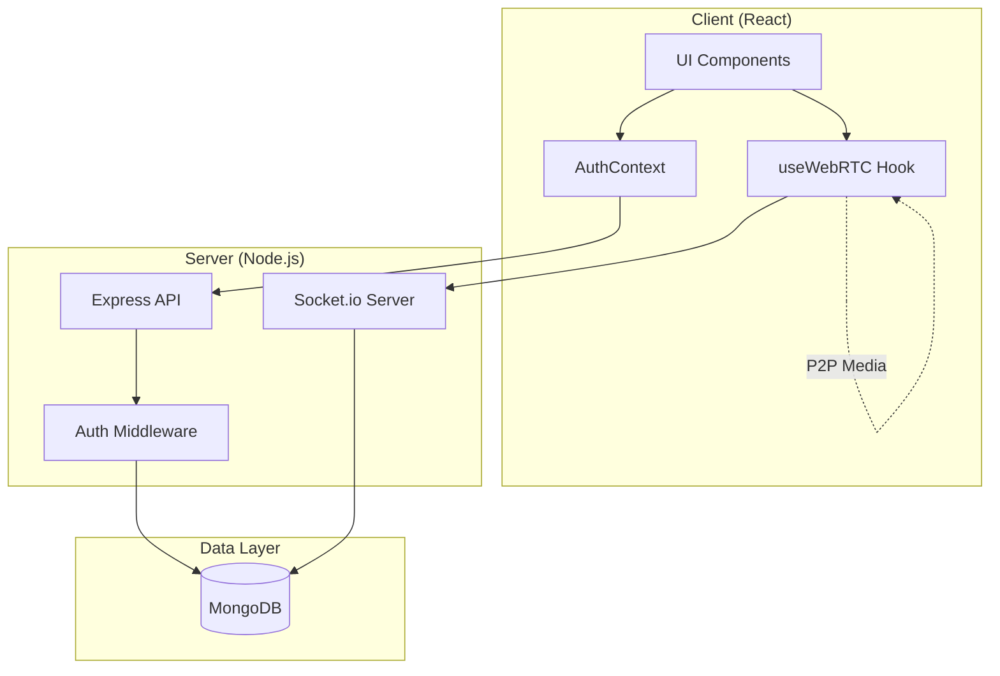
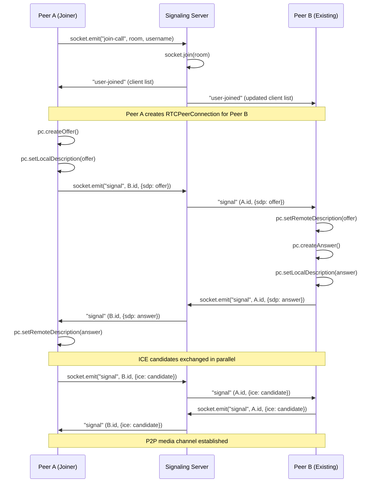

# Architecture

This document covers the system architecture, data flow, and signaling patterns used in Apna Video Call.

---

## System Overview

Apna Video Call is a real-time video conferencing application built on a **WebRTC P2P mesh topology** with centralized signaling through Socket.io. The architecture separates concerns into three layers:

1. **Signaling Layer** — Socket.io server relays SDP offers/answers and ICE candidates between peers
2. **Media Layer** — WebRTC peer connections handle direct audio/video/screen streams
3. **Application Layer** — REST API for authentication, user management, and meeting history



---

## Frontend Architecture

### Component Tree

```
App
├── LandingPage          — Public landing with navigation
├── Authentication       — Login / Registration forms
├── HomeComponent        — Meeting code entry (protected)
│   └── WithAuth HOC     — Route guard
├── VideoMeetComponent   — Meeting room UI
│   └── useWebRTC Hook   — WebRTC + Socket.io logic
└── History              — Past meeting records (protected)
```

### State Management

- **AuthContext** — Provides auth handlers (`handleLogin`, `handleRegister`) and history API access. Memoized to prevent unnecessary re-renders.
- **useWebRTC Hook** — Encapsulates all WebRTC peer connection state, socket events, media toggling, screen sharing, and active speaker detection. The UI layer remains thin and focused on rendering.
- **Component-local state** — UI-specific state (chat messages, form inputs, pagination) stays local to avoid unnecessary global state.

### Key Design Decisions

- **Hook-based WebRTC isolation**: All peer connection, signaling, and media management logic lives in `useWebRTC`. This keeps `VideoMeet.jsx` focused on rendering and user interaction, following the Single Responsibility Principle.
- **Callback refs for video elements**: Video elements use callback refs to eagerly bind `srcObject` on mount, solving a common React+WebRTC race condition where the stream exists before the DOM element.

---

## Backend Architecture

### Module Structure

```
backend/src/
├── app.js                  — Express + HTTP server bootstrap
├── config.js               — Centralized environment config
├── controllers/
│   ├── user.controller.js  — Auth + meeting history handlers
│   └── socketManager.js    — Socket.io event handlers + signaling relay
├── middleware/
│   └── auth.middleware.js  — JWT token verification
├── models/
│   ├── user.model.js       — User schema (name, username, password)
│   └── meeting.model.js    — Meeting log schema (timestamps, duration)
└── routes/
    └── users.routes.js     — REST route definitions
```

### Security Stack

| Layer | Protection |
|---|---|
| HTTP Headers | Helmet middleware |
| Rate Limiting | 100 requests per 15 min window on auth routes |
| Authentication | Stateless JWT (7-day expiry) |
| Password Storage | bcrypt with 10 salt rounds |
| Input Validation | Required fields, length checks, type checks |
| CORS | Configurable allowed origin |

---

## WebRTC Signaling Flow

The signaling flow follows the standard WebRTC offer/answer model:



### ICE Candidate Queuing

ICE candidates that arrive before the remote SDP description is set are queued in `iceCandidateQRef`. Once `setRemoteDescription` succeeds, the queued candidates are flushed. This prevents the common race condition where fast ICE trickling outpaces the SDP exchange.

---

## Media Flow

### Track Lifecycle

1. **Mount**: `getUserMedia` acquires camera + mic in a single call (iOS WebKit compatibility)
2. **Join**: Tracks start disabled (video off, audio off)
3. **Toggle**: Track `enabled` property is toggled; `media-toggle` socket event notifies peers
4. **Screen Share**: Camera video track is replaced on all peer connection senders via `replaceTrack()`
5. **End Screen Share**: Camera stream is re-acquired, tracks replaced back
6. **Disconnect**: All tracks stopped, peer connections closed, AudioContexts closed

### Active Speaker Detection

Uses the Web Audio API (`AnalyserNode`) to poll frequency data from each remote peer's audio stream every 200ms. When the average volume exceeds a threshold (35), that peer is marked as the active speaker. A 2.5-second debounce timeout clears the highlight after silence.

---

## Database Schema

### User

| Field | Type | Notes |
|---|---|---|
| `name` | String | Display name |
| `username` | String | Unique, lowercase, trimmed |
| `password` | String | bcrypt hashed |
| `createdAt` | Date | Auto-managed |
| `updatedAt` | Date | Auto-managed |

### Meeting

| Field | Type | Notes |
|---|---|---|
| `user_id` | String | Maps to username |
| `meetingCode` | String | Room identifier |
| `date` | Date | Entry creation time |
| `joinedAt` | Date | Socket connection time |
| `leftAt` | Date | Socket disconnect time |
| `duration` | Number | Milliseconds |
