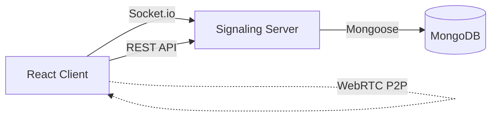

# Apna Video Call

<p align="center">
  
  
  
  
  
  
  
</p>

A real-time video conferencing application built on WebRTC P2P mesh architecture with Socket.io signaling, stateless JWT authentication, and production-oriented security practices. Supports multi-peer video calls, screen sharing, in-call chat, active speaker detection, and automated meeting history tracking.

---

## Features

**Video Conferencing**
- WebRTC mesh topology with multi-peer support
- Camera and microphone toggle with real-time state sync across peers
- Screen sharing with automatic camera restore on stop
- Active speaker detection via Web Audio API frequency analysis
- ICE connection health monitoring with visual reconnection overlays
- iOS Safari / WebKit compatibility (joint `getUserMedia` acquisition)

**Communication**
- In-call chat with message history replay for late joiners
- Chat notification badges for unread messages
- Keyboard shortcuts — M (mic), V (video), Esc (close chat)

**Meeting Management**
- Live meeting duration timer
- Participant count indicator
- Copy meeting link from lobby
- Auto-rejoin on page refresh (session persistence)
- Automated session duration logs (joinedAt → leftAt with duration)
- Meeting history with timestamps and duration display

**User Experience**
- Glassmorphic UI with orientation-aware responsive design
- Avatar placeholders when camera is off (user initials)
- Username display badges on all video feeds
- Device status indicators in lobby (camera/mic ready/blocked)
- Bluetooth audio output redirection mid-call
- Loading states and toast notifications throughout

**Security**
- Stateless JWT authentication (7-day expiry)
- bcrypt password hashing (10 salt rounds)
- Helmet HTTP security headers
- Rate limiting on authentication endpoints
- Input validation and sanitization
- Centralized configuration with fail-fast env validation
- CORS configuration

---

## Architecture

The application uses a three-layer architecture:



- **Signaling**: Socket.io relays SDP offers/answers and ICE candidates
- **Media**: WebRTC peer connections carry audio/video/screen directly between browsers
- **Data**: REST API handles auth, MongoDB stores users and meeting history

> See [ARCHITECTURE.md](./ARCHITECTURE.md) for detailed diagrams and flow documentation.
> See [TECHNICAL_DECISIONS.md](./TECHNICAL_DECISIONS.md) for engineering rationale.

---

## Quick Start

### Prerequisites

- **Node.js** v18+ (tested on v20/v22)
- **MongoDB** — local instance or [MongoDB Atlas](https://www.mongodb.com/atlas) cluster

### 1. Clone and configure

```bash
git clone https://github.com/sanjaynayak1224/Video_Conferencing_Platform.git
cd Video_Conferencing_Platform

cp backend/.env.example backend/.env
# Edit backend/.env with your MongoDB URL and JWT secret
```

### 2. Install dependencies

```bash
cd backend && npm install
cd ../frontend && npm install
```

### 3. Start development servers

```bash
# Terminal 1 — Backend (port 8080)
cd backend && npm run dev

# Terminal 2 — Frontend (port 5173)
cd frontend && npm run dev
```

Open `http://localhost:5173`. The frontend dev server also exposes on your LAN IP for multi-device testing.

### Environment Variables

Create `backend/.env` with:

```env
PORT=8080
MONGO_URL=mongodb+srv://<username>:<password>@cluster.mongodb.net/apnavideocall
JWT_SECRET=your_jwt_signing_secret_key
CORS_ORIGIN=http://localhost:5173
```

---

## API Reference

### Authentication

| Method | Endpoint | Description |
|--------|----------|-------------|
| `POST` | `/api/v1/users/register` | Create account (name, username, password) |
| `POST` | `/api/v1/users/login` | Authenticate and receive JWT |

### Protected Routes

*Requires `Authorization: Bearer <token>` header.*

| Method | Endpoint | Description |
|--------|----------|-------------|
| `GET` | `/api/v1/users/get_all_activity` | Retrieve meeting history |
| `POST` | `/api/v1/users/add_to_activity` | Add meeting to history |

### Socket Events

| Event | Direction | Payload |
|-------|-----------|---------|
| `join-call` | Client → Server | `(roomPath, username)` |
| `user-joined` | Server → Client | `(socketId, clientList)` |
| `signal` | Bidirectional | `(targetId, JSON{sdp/ice})` |
| `chat-message` | Bidirectional | `(text, sender, socketId, timestamp)` |
| `media-toggle` | Bidirectional | `(socketId, {video, audio})` |
| `user-left` | Server → Client | `(socketId)` |

---

## Project Structure

```
├── backend/
│   └── src/
│       ├── app.js                  — Server bootstrap
│       ├── config.js               — Centralized env config
│       ├── controllers/
│       │   ├── user.controller.js  — Auth + history handlers
│       │   └── socketManager.js    — Socket events + signaling
│       ├── middleware/
│       │   └── auth.middleware.js  — JWT verification
│       ├── models/
│       │   ├── user.model.js
│       │   └── meeting.model.js
│       └── routes/
│           └── users.routes.js
├── frontend/
│   └── src/
│       ├── App.jsx                 — Router + providers
│       ├── context/AuthContext.jsx — Auth state + API client
│       ├── hooks/useWebRTC.js      — WebRTC + Socket.io logic
│       ├── pages/                  — Page components
│       ├── styles/                 — Component CSS
│       ├── utils/WithAuth.jsx      — Route guard HOC
│       └── environment.js          — API URL config
├── ARCHITECTURE.md
├── TECHNICAL_DECISIONS.md
├── CONTRIBUTING.md
├── CHANGELOG.md
└── LICENSE
```

---

## Tech Stack

| Layer | Technology | Purpose |
|-------|-----------|---------|
| Frontend | React 19, Vite 8 | UI framework and build tooling |
| UI Library | Material UI 9 | Component library |
| Routing | React Router 7 | Client-side routing |
| HTTP Client | Axios | REST API requests |
| Real-time | Socket.io Client | WebSocket signaling |
| Media | WebRTC API | Peer-to-peer video/audio |
| Backend | Node.js, Express 5 | HTTP + WebSocket server |
| Database | MongoDB (Mongoose 9) | User accounts + meeting history |
| Auth | JSON Web Tokens | Stateless authentication |
| Security | Helmet, express-rate-limit, bcrypt | HTTP headers, rate limiting, password hashing |

---

## Deployment

### Backend

The backend is a standard Node.js application. Deploy to any provider that supports Node.js (Render, Railway, Fly.io, AWS EC2):

```bash
cd backend && npm start
```

Ensure environment variables are configured in your hosting platform.

### Frontend

Build the production bundle:

```bash
cd frontend && npm run build
```

Deploy the `dist/` folder to any static hosting (Vercel, Netlify, Render). No server-side routing config needed — the app uses HashRouter.

---

## Roadmap

- [ ] TURN server integration for symmetric NAT traversal
- [ ] Waiting room with host approval
- [ ] Participant roles (host/moderator/participant)
- [ ] Meeting recording (MediaRecorder API)
- [ ] Virtual backgrounds
- [ ] End-to-end encryption
- [ ] SFU migration for 6+ participant scaling

---

## Contributing

See [CONTRIBUTING.md](./CONTRIBUTING.md) for setup instructions, coding conventions, and contribution workflow.

---

## License

[MIT](./LICENSE)
