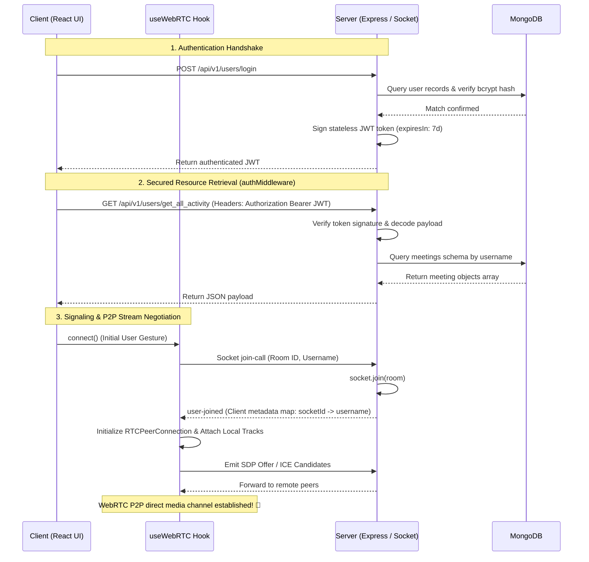

# 🌐 Apna Video Call — High-Fidelity Video Collaboration Platform

<p align="center">
  
  
  
  
  
  
  
</p>

An enterprise-grade, real-time video conferencing application designed to demonstrate robust software engineering practices. Built on a fully decoupled **WebRTC P2P mesh architecture** with Socket.io signaling, stateless JWT session authentication, and defensive security measures (Helmet, rate limiters, strict exception sanitization). Features interactive lobbies, screen sharing, real-time chat, orientation-aware glassmorphic styling, and automated device sync.

---

## 🎨 Core Architectural Enhancements

*   **🗣️ Active Speaker highlighting (Web Audio API)**: Configured custom audio analyser frequency nodes checking remote streams. Highlights speakers with glowing dynamic borders and sorts the layout grid to float the active speaker to the primary grid card.
*   **⏱️ Automated Session Duration Logs**: Combines WebSocket verification with MongoDB triggers. Automatically tracks connection time (from socket handshake to disconnect) and maps periods (e.g. 10:15 AM - 10:45 AM) alongside precise duration counts on History logs.
*   **🍎 iOS Safari & iPadOS WebKit Optimization**: Solved iOS camera stream freeze/black screen bugs by implementing joint single-shot `getUserMedia` capture. This prevents WebKit hardware permission locks from conflicting on sequential device requests.
*   **🔒 Stateless JWT Authentication**: Protected backend routes verified statelessly via a centralized Express authorization middleware, replacing resource-heavy database lookups.
*   **🔀 Decoupled WebRTC Hooks (`useWebRTC`)**: Business logic, peer connections, STUN/TURN rules, and socket events are isolated into a custom React hook. The UI remains lightweight, testable, and compliant with the Single Responsibility Principle.
*   **🌐 Native Socket.io Room Routing**: Manual, scale-limiting arrays were refactored to Socket.io's native room managers (`socket.join`), allowing immediate horizontal scaling and Redis adapter clustering.
*   **📡 ICE Connection Health Monitoring**: Monitors remote link stability using WebRTC's ICE connection state change signals. When a peer's connection fluctuates, glassmorphic reconnect/disconnect overlays are displayed dynamically.
*   **📇 display name Synchronization**: Socket join events map socket IDs to user display names, dynamically rendering floating glassmorphic name tags over both local and remote feeds.
*   **🎧 Bluetooth Audio Redirection**: Intercepts hardware `devicechange` signals to dynamically map audio output buffers to newly connected default outputs (like Bluetooth earbuds) mid-call without requiring reloads.

---

## 📊 Request & Media Signaling Flow

The sequence diagram below details the stateless token handshakes, native room registration, and standard WebRTC SDP/ICE candidate signaling:



---

## 🛠️ API & Endpoint Reference

### Authentication Endpoints

#### `POST /api/v1/users/register`
Creates a new user account.
* **Payload**:
  ```json
  {
    "name": "John Doe",
    "username": "johndoe",
    "password": "securepassword123"
  }
  ```
* **Success Response** (`201 Created`):
  ```json
  { "message": "User registered successfully" }
  ```

#### `POST /api/v1/users/login`
Authenticates user and returns a stateless token.
* **Payload**:
  ```json
  {
    "username": "johndoe",
    "password": "securepassword123"
  }
  ```
* **Success Response** (`200 OK`):
  ```json
  {
    "token": "eyJhbGciOiJIUzI1NiIsInR5cCI6IkpXVCJ9...",
    "message": "Login done successfully"
  }
  ```

---

### Protected History Endpoints
*Must include `Authorization: Bearer <token>` in request headers.*

#### `GET /api/v1/users/get_all_activity`
Retrieves the logged-in user's meeting join history.
* **Success Response** (`200 OK`):
  ```json
  [
    {
      "_id": "60d0fe4f5311236168a109ca",
      "user_id": "johndoe",
      "meetingCode": "q23eqe",
      "date": "2026-07-02T12:00:00.000Z"
    }
  ]
  ```

#### `POST /api/v1/users/add_to_activity`
Adds a meeting code to the user's meeting history records.
* **Payload**:
  ```json
  { "meeting_code": "q23eqe" }
  ```
* **Success Response** (`201 Created`):
  ```json
  { "message": "Added code to history" }
  ```

---

## ⚙️ Quick Start Setup

### 1. Prerequisites
- **Node.js**: v18+ (tested on Node v20/v22)
- **MongoDB**: Active local daemon or MongoDB Atlas cluster connection string.

### 2. Environment Variables
Create a `.env` file in the `/backend` folder:
```env
PORT=8080
MONGO_URL=mongodb+srv://<username>:<password>@cluster.mongodb.net/apnavideocall
JWT_SECRET=your_jwt_signing_secret_key_2026
CORS_ORIGIN=http://localhost:5173
```

### 3. Install & Launch
Run the following commands to install dependencies and start dev environments:

*   **Start the Backend Server**:
    ```bash
    cd backend
    npm install
    npm run dev
    ```

*   **Start the Frontend App**:
    ```bash
    cd ../frontend
    npm install
    npm run dev
    ```

Open `http://localhost:5173` in your browser. Launch an additional tab or join from another device on the same local network to begin video conferencing.

---

## 🛡️ Security & Performance Standards
- **Express Security**: Integrated `helmet` middleware for standard HTTP header protections, and `express-rate-limit` to prevent brute-force attacks on user routers.
- **Defensive Error Handling**: Catch blocks strip mongoose and directory schema details before reporting failures to clients, logging raw exceptions securely on the server.
- **Resource Management**: Component tear-down blocks stop all active tracks and close unused `AudioContext` buffers to prevent memory leaks.
- **Vite Bundler Compliance**: Production assets are minified and optimized, passing complete ESLint validation with zero style or layout warnings.
